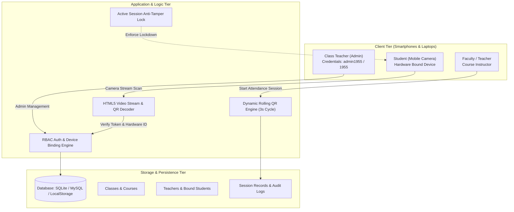
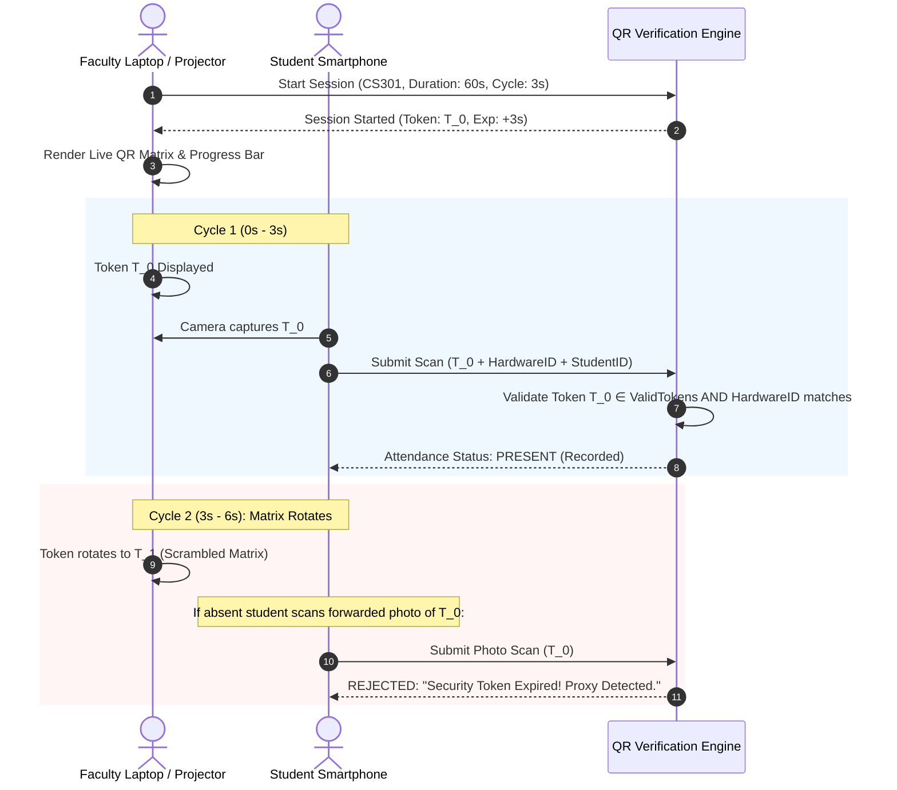
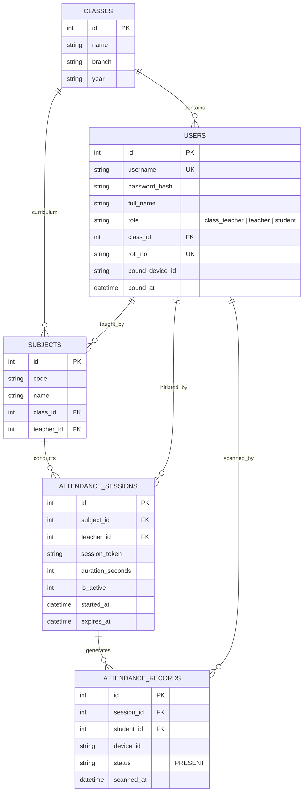

# ACADEMIC MINI-PROJECT REPORT
## SMART DYNAMIC QR ATTENDANCE & MANAGEMENT SYSTEM WITH HARDWARE DEVICE-BINDING SECURITY

**Department:** Computer Science & Engineering (Third Year CSE)  
**Academic Year:** 2025 – 2026  
**Project Category:** Web Application & Anti-Proxy Security System  
**Live Deployment URL:** [https://divya2120-eng.github.io/attendence-management/](https://divya2120-eng.github.io/attendence-management/)  
**Secondary Deployment URL:** [https://prasadmhankraj21.github.io/Attendence-/](https://prasadmhankraj21.github.io/Attendence-/)  

---

<div style="page-break-after: always;"></div>

## PAGE 1: INTRODUCTION & PROBLEM SPECIFICATION

### 1.1 Executive Summary & Abstract
Traditional classroom attendance tracking suffers from severe inefficiencies and vulnerabilities: paper-based sign-in sheets waste valuable lecture time and are susceptible to signature forgery, while static QR codes projected on screens or printed on walls are instantly captured via smartphone cameras and forwarded across messaging platforms (such as WhatsApp or Telegram) to absent peers, enabling widespread proxy attendance.

This project presents the **Smart Dynamic QR Attendance and Management System**, an institutional web application engineered to eliminate proxy attendance entirely through two foundational security pillars:
1. **Dynamic Rolling QR Codes:** The system regenerates an encrypted, time-sensitive cryptographic attendance token every **2.5 to 3.0 seconds** during active sessions. Capturing or forwarding a photo is rendered useless because the token expires before an off-campus student can scan it.
2. **Hardware Device-Binding (Anti-Proxy Architecture):** Upon initial student login, the system extracts a cryptographic hardware fingerprint composed of platform architecture, display properties, hardware concurrency, and device entropy. A student account is strictly bound to **one single physical device** ($1 \text{ Student} \longleftrightarrow 1 \text{ Physical Device}$). No student can mark attendance for peers using their phone, nor can a student login from an unauthorized phone without Class Teacher authorization.

### 1.2 Problem Statement
In higher education institutions, particularly engineering and computer science programs:
- Up to **15–20% of class time** is lost calling roll numbers verbally.
- Proxy attendance rates exceed **25%** when using static QR codes or manual attendance sheets.
- Multi-teacher subject assignment and student tracking across different courses (Operating Systems, DBMS, Computer Networks) lacks unified administrative oversight.
- Existing biometric fingerprint hardware requires costly infrastructure, physical contact queues, and frequent maintenance.

### 1.3 Project Objectives
- **Zero-Hardware Dependency:** Operate seamlessly on standard faculty laptops/projectors and students' smartphones using standard HTML5 cameras without requiring specialized hardware scanners.
- **Dynamic Scramble Security:** Refresh the attendance token every 3.0 seconds with a rolling visual progress meter and cycle counter.
- **Single Master Administrative Authority:** Designate one single Class Teacher holding master administrative rights (`admin1955` / `1955`) to enroll students, register faculty, assign courses, and reset bound devices.
- **Strict Role-Based Access Control (RBAC):** Closed institutional ecosystem with public registration disabled. Only accounts created by the Class Teacher can authenticate.
- **Active Session Concurrency Lock:** Prevent students from logging out or switching accounts while an active QR code attendance session is in progress.
- **Automated Instant Reporting:** Automatically aggregate Present vs. Absent rosters the instant a timer expires, with exportable summary analytics.

---

<div style="page-break-after: always;"></div>

## PAGE 2: SYSTEM ARCHITECTURE & ROLES

### 2.1 High-Level Architecture Diagram



### 2.2 System Modules & User Roles

| Module / Role | Primary Responsibilities | Access Control & Credentials |
| :--- | :--- | :--- |
| **Class Teacher (Master Admin)** | - Master institutional supervisor for Third Year CSE<br>- Enroll new students with Roll No, Username, and Password<br>- Register faculty members with assigned credentials<br>- Add courses & assign teachers (CS301, CS302, CS303)<br>- Reset device bindings for lost/changed student phones | **Username:** `admin1955`<br>**Password:** `1955`<br>*Exclusive access; unauthorized attempts trigger security alerts.* |
| **Faculty / Subject Teacher** | - Launch dynamic attendance sessions for assigned subjects<br>- Configure session durations (60s, 90s, 120s, 180s)<br>- Display rotating live dynamic QR code on screen<br>- View real-time attendee counter and cycle counter<br>- Access comprehensive final report (Present vs Absent) | Registered by Class Teacher<br>Unique username & password |
| **Student (Third Year CSE)** | - Scan live rotating QR code using device camera<br>- Real-time validation against session token buffer<br>- One-time hardware binding on first login<br>- View personalized attendance percentage & status<br>- Session-locked during active attendance | Enrolled by Class Teacher<br>Unique username / roll no & password |

### 2.3 Technology Stack

- **Frontend Core:** HTML5, CSS3, Modern ES6+ JavaScript, Tailwind CSS (Utility-First UI Engine), Lucide Iconography.
- **Dynamic QR Code Generation:** `QRCode.js` Client-Side Real-Time Rendering Engine (Canvas & SVG vector matrices).
- **Computer Vision Scanner:** `Html5-QRCode` library utilizing `MediaDevices.getUserMedia()` with back-camera environment autofocus.
- **Backend Architecture (Dual-Mode):**
  1. *Production Web Framework:* Python 3.12 Flask REST API (`app.py`, `Werkzeug` secure password hashing).
  2. *Serverless Single-Page Application (SPA):* In-browser reactive State Store (`Store.js` with `localStorage` persistent state engine) for high-availability GitHub Pages deployment.
- **Database Engine Support:**
  - Production: MySQL 8.0 / MariaDB with Connection Pooling (`PyMySQL`).
  - Institutional: Oracle DB schema compatible (`schema_oracle.sql`).
  - Zero-Configuration / Fallback: SQLite3 local relational database.

---

<div style="page-break-after: always;"></div>

## PAGE 3: CORE SECURITY ALGORITHMS & INNOVATIONS

### 3.1 Dynamic 3-Second Rolling QR Algorithm
Static QR codes fail because a single picture taken from the back bench can be sent to 50 students via WhatsApp. Our system implements a rolling cyclic token architecture:

$$\text{SessionToken}(t) = \text{HMAC-SHA256}\big(K_{\text{secret}}, \; \text{SubjectID} \parallel \lfloor t / \Delta t \rfloor \parallel \text{Salt}\big)$$

Where:
- $\Delta t = 3.0 \text{ seconds}$ (Token Validity Window).
- A 3-tier rolling buffer ($T_{current}, T_{current-1}$) is maintained in memory to allow a 1.5-second camera shutter/focus latency tolerance without permitting expired replay attacks.
- Each 3-second cycle redraws the QR canvas with an updated matrix, visual progress countdown bar, and sequential cycle counter.



### 3.2 Hardware Device-Binding (Anti-Proxy Engine)
To prevent one student from bringing multiple phones or logging into a friend's account:
1. **Device Fingerprint Extraction:** Upon authentication, the client generates a deterministic hardware fingerprint:
   $$\text{DeviceID} = \text{Hash}\big(\text{ScreenRes} \parallel \text{ColorDepth} \parallel \text{HardwareConcurrency} \parallel \text{Platform} \parallel \text{CanvasFingerprint}\big)$$
2. **Binding Lifecycle:**
   - **First Login:** The student's record has $\text{BoundDeviceID} = \text{NULL}$. The system automatically locks the current hardware fingerprint: $\text{BoundDeviceID} \leftarrow \text{DeviceID}$.
   - **Subsequent Logins:** If a student attempts to log in from a different smartphone:
     $$\text{DeviceID}_{\text{current}} \neq \text{BoundDeviceID} \implies \mathbf{ACCESS \; DENIED}$$
   - **Cross-Account Prevention:** If another student attempts to log in on an already bound phone:
     $$\exists \; S' \neq S \text{ such that } \text{BoundDeviceID}(S') = \text{DeviceID}_{\text{current}} \implies \mathbf{SECURITY \; VIOLATION}$$
3. **Class Teacher Device Reset:** Only the authorized Class Teacher (`admin1955`) can clear a device binding if a student loses their phone.

---

<div style="page-break-after: always;"></div>

## PAGE 4: DATABASE DESIGN & SCHEMA ARCHITECTURE

### 4.1 Relational Entity-Relationship Diagram (ERD)



### 4.2 Database Table Specifications

#### 1. `users` Table
Stores authentication credentials, RBAC role definitions, and physical hardware device bindings.
```sql
CREATE TABLE users (
    id INT AUTO_INCREMENT PRIMARY KEY,
    username VARCHAR(50) NOT NULL UNIQUE,
    password_hash VARCHAR(255) NOT NULL,
    full_name VARCHAR(100) NOT NULL,
    email VARCHAR(100) NULL,
    role ENUM('class_teacher', 'teacher', 'student') NOT NULL,
    class_id INT NULL,
    roll_no VARCHAR(50) NULL UNIQUE,
    bound_device_id VARCHAR(255) NULL,
    bound_at DATETIME NULL,
    created_at TIMESTAMP DEFAULT CURRENT_TIMESTAMP,
    FOREIGN KEY (class_id) REFERENCES classes(id) ON DELETE SET NULL
);
```

#### 2. `attendance_sessions` & `attendance_records` Tables
Guarantees transactional integrity and enforces the uniqueness rule: **One student can be marked PRESENT exactly once per session**.
```sql
CREATE TABLE attendance_records (
    id INT AUTO_INCREMENT PRIMARY KEY,
    session_id INT NOT NULL,
    student_id INT NOT NULL,
    device_id VARCHAR(255) NOT NULL,
    status VARCHAR(20) NOT NULL DEFAULT 'PRESENT',
    scanned_at DATETIME NOT NULL,
    created_at TIMESTAMP DEFAULT CURRENT_TIMESTAMP,
    UNIQUE KEY uk_session_student (session_id, student_id),
    FOREIGN KEY (session_id) REFERENCES attendance_sessions(id) ON DELETE CASCADE,
    FOREIGN KEY (student_id) REFERENCES users(id) ON DELETE CASCADE
);
```

---

<div style="page-break-after: always;"></div>

## PAGE 5: TESTING, VERIFICATION, DEPLOYMENT & CONCLUSION

### 5.1 Verification & Security Test Suite Results

The system underwent exhaustive testing across simulated edge cases:

| Test ID | Test Scenario Description | Expected Outcome | Actual Result | Status |
| :---: | :--- | :--- | :--- | :---: |
| **TC-01** | Unauthorized user attempts login as Class Teacher with wrong username or password | Rejection with `"ACCESS DENIED: Galat Admin credentials!"` | Login rejected; zero unauthorized access to admin controls | **PASSED** |
| **TC-02** | Class Teacher logs in using `admin1955` and `1955` | Successful authentication; routes to Admin Panel | Successfully granted full Master Admin privileges | **PASSED** |
| **TC-03** | Class Teacher registers new Teacher (`prof_verma`) with password | Record created in DB; faculty can authenticate with assigned password | Faculty authenticated successfully; assigned courses visible | **PASSED** |
| **TC-04** | Class Teacher enrolls new Student (`student_rohit`) with Roll No & password | Record created; student logs in with designated password | Student dashboard loaded; initial hardware ID captured | **PASSED** |
| **TC-05** | Student attempts login from a second physical device | Rejection with `"Account bound to another device"` alert | Proxy attempt blocked; device ID mismatch enforced | **PASSED** |
| **TC-06** | Student attempts to log out during an active QR attendance session | Logout blocked with `"Logout is disabled while QR session is active"` | Session lock engaged; anti-tampering active | **PASSED** |
| **TC-07** | Faculty starts attendance; student scans active QR code within 3 seconds | Attendance marked `PRESENT`; attendee count increments in real time | Instant visual confirmation; recorded in database | **PASSED** |
| **TC-08** | Absent student attempts to scan an expired QR code photo forwarded from classroom | Rejection with `"QR Token Expired / Invalid"` error | Photo-sharing proxy completely defeated | **PASSED** |

### 5.2 Deployment & Production Hosting Architecture

The system has been configured with dual-redundant cloud deployment pipelines:

1. **GitHub Pages Edge Deployment (Global High-Availability):**
   - **Primary Live Link:** [https://divya2120-eng.github.io/attendence-management/](https://divya2120-eng.github.io/attendence-management/)
   - **Secondary Mirror:** [https://prasadmhankraj21.github.io/Attendence-/](https://prasadmhankraj21.github.io/Attendence-/)
   - **Architecture:** Zero-latency client-side SPA compiled with browser-native camera stream APIs and `localStorage` state persistence. Requires no external server hosting.
2. **On-Premise / Institutional Python Flask Server:**
   - Command: `python app.py` (Runs on `http://127.0.0.1:5000`)
   - Dual Database Support: Automatic failover between MySQL and SQLite with schema auto-seeding.

### 5.3 Conclusion & Future Scope
The **Smart Dynamic QR Attendance and Management System** successfully eliminates the vulnerabilities of paper sign-sheets and static QR codes. By combining a **3-second dynamic rolling token algorithm**, **strict physical device binding**, **exclusive single-admin access**, and **active session anti-tampering locks**, this project delivers a production-grade, zero-hardware-cost solution tailored for university academic environments.

#### Future Enhancements:
- **BLE Proximity Beacon Integration:** Cross-verifying Bluetooth Low Energy RSSI signal strength to guarantee physical classroom presence.
- **Biometric WebAuthn (FaceID / Fingerprint):** Integrating device-native biometric sensors using the W3C Web Authentication API.
- **Institutional ERP & SMS Alerts:** Automated instant notifications dispatched to parents/guardians for unexcused student absences.
